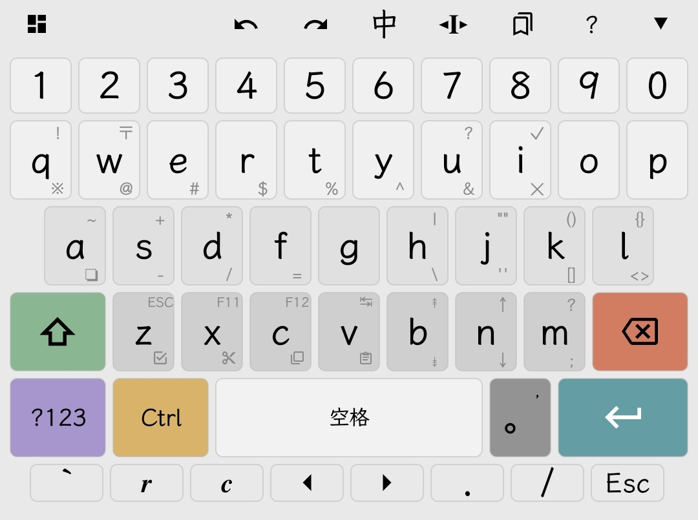
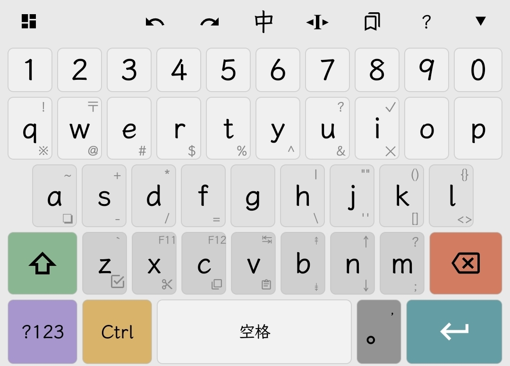
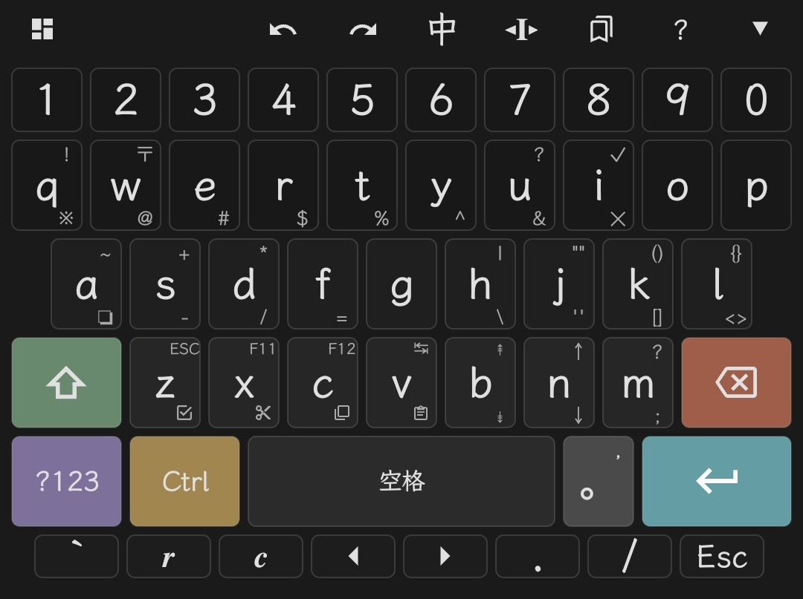
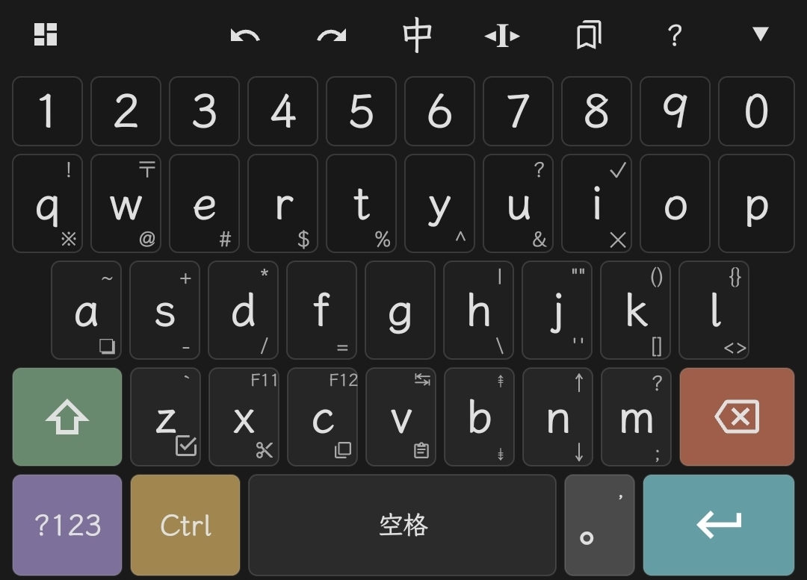

# GeekGT

改版自 `lesca/geek-ime`。

## 效果预览

| Apples 版 | Alpha 版 |
| :---: | :---: |
|  亮色 |  亮色 |
|  暗色 |  暗色 |

## 使用方法

1. 把 `GeekGT_版本代号.trime.yaml`（如 `GeekGT_Apples.trime.yaml` 或 `GeekGT_Alpha.trime.yaml`）放入同文输入法（Trime）工作目录文件夹中。
2. 重新部署并在主题设置中选用对应皮肤。
3. 皮肤内置的使用说明位于顶部工具栏的 **`？`** 按钮处（点击可打开独立说明面板，长按可一键发送完整说明文本）。

## 开源协议

本项目基于 [GPL-3.0](LICENSE) 协议开源。
